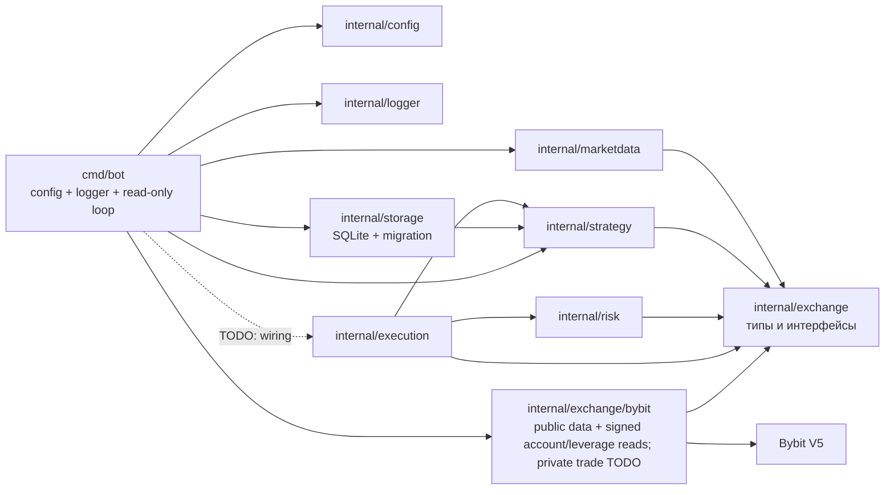

# Архитектура

Документ описывает фактическую структуру на 2026-07-27 и отдельно отмечает
целевые, но ещё не соединённые части MVP. Бизнес-формулы находятся в
[DOMAIN.md](DOMAIN.md), контракты — в [API.md](API.md).

## Форма системы

Проект — модульный монолит: один Go-модуль `bybit_bot_liquidity`, один процесс
`cmd/bot`, пакеты предметной области закрыты в `internal/`. Сетевого входного API,
очереди сообщений и фонового планировщика сейчас нет.

Сплошные стрелки показывают существующие зависимости или реализованную внешнюю
возможность, пунктир — wiring, которого в приложении пока нет.

## Компоненты

| Компонент | Вход | Выход | Статус |
| --- | --- | --- | --- |
| `cmd/bot` | путь к конфигурации, env credentials, сигналы ОС | startup readiness report, read-only market loop, WebSocket lifecycle, логи и корректное завершение | private reads опциональны; торговлю не исполняет |
| `config` | файл с простым YAML-подобным синтаксисом | проверенный `Config` | работает для текущего файла |
| `logger` | writer и уровень | JSON `slog.Logger` | работает |
| `exchange` | — | общие структуры и `Client` | контракт определён |
| `exchange/bybit` | REST/WS URL, credentials и transports | public data, signed account/balance/position/leverage, liquidation stream | candles/OI/ticker/rules, account info, wallet balance, one-way position/leverage и `allLiquidation` реализованы; private order/close — заглушки |
| `marketdata` | клиент, символ, OI-окно, лимит свечей, ликвидации | `Snapshot`, настроенное окно | подключён к REST polling и WebSocket accumulator |
| `strategy` | подтверждённые свечи, два значения OI, ликвидации, время | `Signal` или `Evaluation{Signal, Indicators}` | период SMA и пороги настраиваются; detailed path рассчитывает диагностику без short-circuit |
| `risk` | баланс, цена входа, сторона и процентные резервы | количество, SL, TP, риск USD | работает и тестируется |
| `papertrade` | сигнал, подтверждённые свечи, risk/trading config | виртуальный plan/outcome | подключён к read-only loop; состояние позиции хранится в памяти |
| `execution` | account/leverage info либо сигнал, баланс, цена, биржа, risk manager, store | readiness snapshot, нормализованный ордер или ошибка | readiness вызывается на startup при credentials; executor не подключён |
| `storage` | `database/sql` либо driver+DSN | миграция, сигналы с virtual outcome, сделки, статистика | CGo-free SQLite подключён |

## Потоки данных

### Фактический поток запуска

1. `cmd/bot` читает флаг `-config` (по умолчанию `configs/config.yaml`).
2. `config.Load` начинает с дефолтов, применяет найденные значения и выполняет
   числовую валидацию.
3. `logger.New` создаёт JSON-логгер, процесс пишет `bot initialized`.
4. `cmd/bot` открывает SQLite, проверяет соединение и применяет идемпотентную
   начальную миграцию.
5. `cmd/bot` создаёт public либо authenticated REST client. При наличии
   credentials он синхронно выполняет execution readiness и логирует безопасный
   итог; ошибка не останавливает read-only запуск.
6. `cmd/bot` создаёт WebSocket liquidation client, collector с
   `strategy.oi_window_minutes`, окно
   `strategy.liquidation_window_minutes`, strategy и paper-trade engine с
   виртуальным балансом.
7. WebSocket-горутинa подписывается на `allLiquidation.{symbol}`, отправляет
	heartbeat и переподключается с экспоненциальным backoff (5 секунд—1 минута) и
	jitter. После неожиданного разрыва accumulator очищается: historical replay
	публичного liquidation stream недоступен, поэтому окно после разрыва считается
	новым и неполным до истечения его retention.
8. Read-only loop сразу собирает первый снимок, сохраняет предыдущий OI в памяти,
   затем каждые 30 секунд собирает новый снимок с окном ликвидаций. На каждом
   снимке paper-trade проверяет выход открытой виртуальной позиции. Внутри того
   же timestamp OI runner только обновляет предыдущее OI; при переходе к
   следующему timestamp рассчитывает и сохраняет сигнал, а для допущенного
   `LONG`/`SHORT` открывает virtual plan.
9. Процесс ждёт `SIGINT` или `SIGTERM`, останавливает горутины, закрывает БД и
   пишет `bot stopped`.

Без credentials биржевые вызовы в этом потоке только публичные REST/WebSocket.
С credentials добавляется один набор signed startup reads; SQL используется для
миграции и сигналов, торговое исполнение не происходит.

### Предусмотренный торговый поток

Этот путь выражен типами и отдельными пакетами, но оркестрирован только до
read-only сигнала:

1. `marketdata.Collector` запрашивает свечи и текущее OI; накопитель передаёт
   события ликвидаций за настроенное окно.
2. `cmd/bot` хранит предыдущее OI в памяти и собирает `strategy.Input`.
3. `strategy.Strategy` возвращает `LONG`, `SHORT` или `NONE`, а `cmd/bot`
   сохраняет и логирует сигнал.
4. `execution.Executor` пока не подключён. В целевом торговом пути он сначала
   должен применить `trading.dry_run`, дневной лимит, cooldown и лимит позиции,
   затем вызвать `risk.Manager` и при разрешённом режиме отправить
   `OrderRequest` бирже.
5. Закрытие позиции, сохранение сделки и вызов `MarkPositionClosed` должен
   выполнить внешний оркестратор; такого кода пока нет.

`ExecutionReadinessPreflight` уже агрегирует реализованные
`GetAccountInfo`/`GetPosition`/`GetAccountBalance`/`GetLastPrice`/`GetLeverage`
и instrument rules. Он требует Unified `REGULAR_MARGIN`, отсутствие позиции,
положительный available balance, корректные цены и допустимое текущее one-way
leverage. Результат пока не передаётся executor и не вызывается из фактического
торгового потока. `cmd/bot` использует его только для non-fatal startup report
при credentials; preflight не вычисляет required margin и не изменяет настройки
аккаунта.

### Поток хранения

`storage.Store.Migrate` создаёт таблицы `trades` и `signals`. `SaveSignal` и
`SaveTrade` выполняют одиночные вставки; расширенный signal record сохраняет
полный typed indicator snapshot и paper-trade plan, а отдельный update фиксирует
outcome. `Stats` последовательно читает только PnL закрытых строк `trades` и
считает агрегаты в памяти. `cmd/bot` открывает настроенный DSN, вызывает
миграцию при каждом старте и сохраняет каждый вычисленный сигнал.

## Ключевые границы

- `exchange/bybit` переводит внешние форматы в типы `exchange` и не принимает
  торговых решений.
- `marketdata` собирает REST-снимок и хранит ограниченное окно событий, не
  принимает торговых решений.
- `strategy`, `risk` и `papertrade` детерминированы своими входами и не выполняют
  I/O; состояние paper-trade ограничено памятью процесса.
- `execution` координирует доменные сервисы, но не знает SQL и конкретный Bybit.
- `storage` принимает доменные значения, но не управляет торговым циклом.
- `cmd/bot` должен остаться composition root: создавать зависимости, запускать и
  останавливать горутины, не содержать формул стратегии.

Интерфейсы для рыночных данных и исполнения объявлены со стороны потребителей;
полный `exchange.Client` остаётся контрактом адаптера. Детали методов — в
[API.md](API.md#внутренние-go-контракты).

## Жизненный цикл и отказоустойчивость

В текущем потоке read-only loop работает в основной горутине, а WebSocket reader
и accumulator — в двух фоновых. Все операции получают корневой `context.Context`,
а `main` дожидается завершения фоновых горутин.
Перед добавлением торгового исполнения необходимо:

- определить freshness/политику допуска неполного окна ликвидаций к стратегии;
- определить retry/rate-limit/idempotency для ордеров (для public reads уже
	есть ограниченный retry только для классифицированных временных ошибок);
- восстановить открытую позицию и cooldown после перезапуска;
- восстановить торговое состояние из SQL при остановке/рестарте.

Все пункты — `TODO`; подтверждённых реализаций или политик в репозитории нет.

## Текущее состояние и разрывы

До заявленной цели MVP не хватает как минимум:

- private order/close transport Bybit поверх реализованной GET-аутентификации;
- выбора целевого leverage и проверки достаточности маржи;
- wiring реализованного execution readiness в торговый orchestrator;
- подключения executor к рассчитанному сигналу;
- подключения `trading` как обязательных execution gates, включая dry-run и
  подсчёт сделок за согласованную границу дня;
- восстановления открытой paper-trade позиции, cooldown и дневного счётчика из
  SQLite после рестарта;
- агрегированной статистики по virtual PnL;
- сохранения и восстановления полного жизненного цикла сделки;
- мониторинга закрытия по SL/TP и обновления cooldown;
- фактического учёта комиссий и проскальзывания поверх настроенных оценок;
- интеграционных тестов в Testnet и операционных защит.

Приоритет и конкретный план этих работ не определены: см.
[открытые решения](DECISIONS.md#открытые-решения) и актуальный
[handoff](../.ai/HANDOFF.md).
