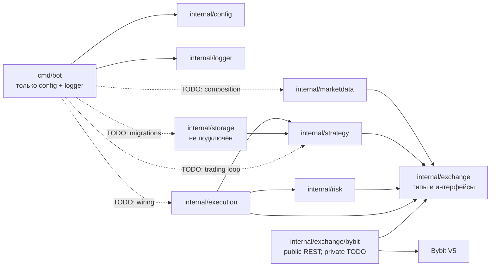

# Архитектура

Документ описывает фактическую структуру на 2026-07-22 и отдельно отмечает
целевые, но ещё не соединённые части MVP. Бизнес-формулы находятся в
[DOMAIN.md](DOMAIN.md), контракты — в [API.md](API.md).

## Форма системы

Проект — модульный монолит: один Go-модуль `bybit_bot_liquidity`, один процесс
`cmd/bot`, пакеты предметной области закрыты в `internal/`. Сетевого входного API,
очереди сообщений и фонового планировщика сейчас нет.

Сплошные стрелки показывают существующие зависимости или реализованную внешнюю
возможность, пунктир — wiring, которого в приложении пока нет.

## Компоненты

| Компонент | Вход | Выход | Статус |
| --- | --- | --- | --- |
| `cmd/bot` | путь к конфигурации, сигналы ОС | логи и корректное завершение | работает, но торговые компоненты не собраны |
| `config` | файл с простым YAML-подобным синтаксисом | проверенный `Config` | работает для текущего файла |
| `logger` | writer и уровень | JSON `slog.Logger` | работает |
| `exchange` | — | общие структуры и `Client` | контракт определён |
| `exchange/bybit` | base URL и HTTP client | методы `exchange.Client` | candles/OI реализованы и тестируются; private trade/position — заглушки |
| `marketdata` | клиент, символ, лимит свечей, внешние ликвидации | `Snapshot` | может работать поверх public REST, но не подключён в `main` |
| `strategy` | 21+ свеча, два значения OI, ликвидации, время | `Signal` | работает и тестируется |
| `risk` | баланс, цена входа, сторона | количество, SL, TP, риск USD | работает и тестируется |
| `execution` | сигнал, баланс, цена, биржа, risk manager, store | ордер или ожидаемая ошибка | работает с fake-зависимостями |
| `storage` | `database/sql` либо driver+DSN | миграция, записи, статистика | код есть; драйвер и wiring отсутствуют |

## Потоки данных

### Фактический поток запуска

1. `cmd/bot` читает флаг `-config` (по умолчанию `configs/config.yaml`).
2. `config.Load` начинает с дефолтов, применяет найденные значения и выполняет
   числовую валидацию.
3. `logger.New` создаёт JSON-логгер, процесс пишет `bot initialized`.
4. Процесс ждёт `SIGINT` или `SIGTERM`, затем пишет `bot stopped`.

Никакие биржевые или SQL-вызовы в этом потоке не происходят.

### Предусмотренный торговый поток

Этот путь выражен типами и отдельными пакетами, но ещё не оркестрирован:

1. `marketdata.Collector` запрашивает свечи и текущее OI; события ликвидаций
   вызывающий код должен передать ему уже накопленными.
2. Оркестратор должен хранить предыдущее OI и собрать `strategy.Input`.
3. `strategy.Strategy` возвращает `LONG`, `SHORT` или `NONE`.
4. `execution.Executor` сначала сохраняет сигнал, проверяет cooldown и отсутствие
   позиции, затем вызывает `risk.Manager` и отправляет `OrderRequest` бирже.
5. Закрытие позиции, сохранение сделки и вызов `MarkPositionClosed` должен
   выполнить внешний оркестратор; такого кода пока нет.

Входы `balance` и `entryPrice` для executor тоже должен получить оркестратор.
Контракт получения баланса в проекте отсутствует (`TODO`).

### Поток хранения

`storage.Store.Migrate` создаёт таблицы `trades` и `signals`. `SaveSignal` и
`SaveTrade` выполняют одиночные вставки; `Stats` последовательно читает PnL
закрытых сделок и считает агрегаты в памяти. Миграция не вызывается из `main`, а
драйвер SQLite не зарегистрирован.

## Ключевые границы

- `exchange/bybit` переводит внешние форматы в типы `exchange` и не принимает
  торговых решений.
- `marketdata` только собирает данные; накопление WebSocket-событий и расписание
  обновлений находятся за его текущей границей.
- `strategy` и `risk` детерминированы своими входами и не выполняют I/O.
- `execution` координирует доменные сервисы, но не знает SQL и конкретный Bybit.
- `storage` принимает доменные значения, но не управляет торговым циклом.
- `cmd/bot` должен остаться composition root: создавать зависимости, запускать и
  останавливать горутины, не содержать формул стратегии.

Интерфейсы для рыночных данных и исполнения объявлены со стороны потребителей;
полный `exchange.Client` остаётся контрактом адаптера. Детали методов — в
[API.md](API.md#внутренние-go-контракты).

## Жизненный цикл и отказоустойчивость

В текущем потоке `main` единственный управляемый ресурс — контекст от сигналов ОС;
горутины и сетевые соединения не создаются. Перед добавлением торгового цикла
необходимо:

- связать все долгие операции с корневым контекстом и дождаться их завершения;
- определить интервалы свечей/OI и защиту от повторной обработки;
- реализовать WebSocket reconnect, backoff и восстановление окна ликвидаций;
- определить retry/rate-limit/idempotency для REST и ордеров;
- восстановить открытую позицию и cooldown после перезапуска;
- закрывать SQL и сетевые ресурсы при остановке.

Все пункты — `TODO`; подтверждённых реализаций или политик в репозитории нет.

## Текущее состояние и разрывы

До заявленной цели MVP не хватает как минимум:

- приватной REST-аутентификации и методов ордеров/позиций Bybit;
- WebSocket-клиента ликвидаций;
- контракта баланса и получения надёжной цены входа;
- композиции collector → strategy → executor;
- SQLite-драйвера, запуска миграции и сохранения жизненного цикла сделки;
- мониторинга закрытия по SL/TP и обновления cooldown;
- проверки шага количества, минимального номинала, точности цены и комиссий;
- интеграционных тестов в Testnet и операционных защит.

Приоритет и конкретный план этих работ не определены: см.
[открытые решения](DECISIONS.md#открытые-решения) и
[текущую задачу](../.ai/CURRENT_TASK.md).
